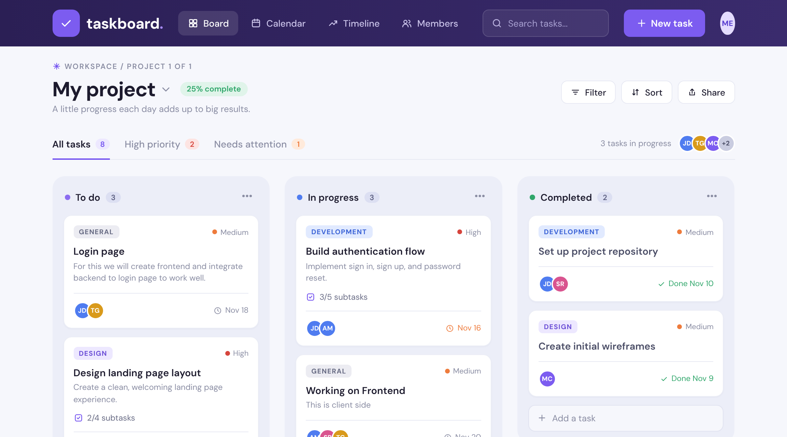

# Todo List: taskboard

A project and task manager with a kanban board: **To do → In progress → Completed**. Tasks live in projects, you can drag them between columns, open any task to see or edit its details, and everything is saved in your browser. Built with vanilla JavaScript, webpack and [date-fns](https://github.com/date-fns/date-fns) for The Odin Project.



## Features

- **Projects:** there is always a default project ("My project") that new tasks go into, and it can't be deleted. Click the project title to switch projects, create new ones or delete them. When you add or edit a task you choose which project it belongs to.
- **Tasks** have a title, description, due date, priority, notes and subtasks (checklist), plus a status, a category and assignee initials.
- **Board:** every task in the project shows its category, priority (coloured dot), subtask progress, assignees and due date. Overdue dates turn orange. Finished tasks show when they were completed.
- **Move tasks** by dragging a card to another column, or change the status in the task dialog.
- **Open a task** (click a card) to see all its details, edit anything, tick subtasks, move it to another project, or delete it.
- **Find things:** search box in the top bar, tabs (All tasks / High priority / Needs attention), a Filter menu (priority, category) and a Sort menu (due date, priority, newest, title).
- **Share** copies a plain-text summary of the project to your clipboard.
- **Persistence:** projects and tasks are saved to `localStorage` after every change and restored on load. Missing or corrupted saved data never crashes the app.
- **Unfinished work survives a reload:** whatever you type in the task form (title, description, dropdowns, date, assignees, notes, subtasks, even a subtask you typed but haven't added) is saved as you type. Reload the page and the form reopens exactly as you left it. Saving, Cancel or Escape clears it. The half-typed project name, the search text, the selected project, tab, sort and filters are restored too.
- **Form validation (JavaScript only):** the forms use `novalidate` and the Constraint Validation API. Fields are checked as you type and when you leave them: red border and a message when something is wrong, green when it is fine. Submitting with errors shows "Please fix the highlighted fields before saving." and jumps to the first problem. Rules: title 3–80 characters (not just spaces), description ≤ 300, notes ≤ 500, subtask ≤ 60, assignees 1–3 letters each (max 4 people), new tasks can't have a due date in the past, and project names are 2–30 characters and unique.
- Responsive: the columns stack on small screens.

The Calendar, Timeline and Members tabs in the top bar are placeholders for later.

## How to run it

Requires Node.js 22 or newer.

```bash
npm install
npm run dev      # dev server at http://localhost:3000
npm test         # unit tests for the logic, validation and storage
npm run lint     # ESLint (should print nothing)
npm run format   # Prettier: format every file
npm run build    # production bundle in dist/
```

ESLint 10 needs Node 22.13 or newer.

## How it's organised

Application logic and DOM code live in separate modules. Nothing in `src/logic/` touches the page, which is why it can be unit-tested in Node.

```
src/
├── logic/                 # no DOM in here
│   ├── todo.js            # Todo class: its own data and rules
│   ├── project.js         # Project class: a named list of todos
│   ├── projectManager.js  # all projects, the default project, moving todos
│   ├── views.js           # tabs, filtering, searching, sorting, grouping, saved view
│   └── validation.js      # form rules as pure functions (no DOM)
├── dom/                   # no business rules in here
│   ├── navbar.js          # top bar
│   ├── header.js          # title, project menu, filter/sort/share, tabs
│   ├── board.js           # columns, cards, drag and drop
│   ├── taskDialog.js      # create / view / edit / delete form
│   ├── validation.js      # Constraint Validation API helpers + error display
│   ├── menu.js            # small popover menus
│   ├── avatars.js, icons.js, dates.js, toast.js, el.js
├── storage.js             # localStorage: app data, unfinished form draft, view
├── index.js               # connects logic to DOM, saves after each change
├── styles.css
└── template.html
test/                      # node:test unit tests
eslint.config.mjs          # ESLint (recommended rules + a few extras)
.prettierrc.json           # Prettier settings
```

## Linting and formatting

- **ESLint** (`eslint.config.mjs`) uses the recommended rule set plus `eqeqeq`, `no-var` and `prefer-const`.
- **Prettier** (`.prettierrc.json`) formats everything. Run `npm run format` before committing and `npm run format:check` to verify.

## Design notes

- **Classes with private fields (encapsulation):** a `Todo` can only change through `update()`, `toggle()`, `setStatus()` and the checklist methods. They validate everything before changing anything, so a task is never half-updated or invalid.
- **Single responsibility:** `Todo` knows about itself, `Project` about its todos, `ProjectManager` about its projects, `views.js` about what to show, `storage.js` only saves and loads, and each DOM module draws one part of the page.
- **Getting methods back after loading:** JSON can't store methods, so `toJSON()` writes out the plain data and `fromJSON()` rebuilds real `Todo`, `Project` and `ProjectManager` objects. A damaged task is skipped instead of losing everything, and data saved by an older version still loads.
- **No `innerHTML` with user text:** the DOM modules build elements with `textContent`, so a task titled `<script>` is just text.
